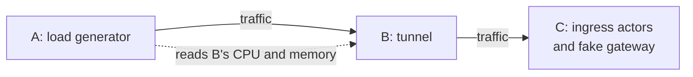
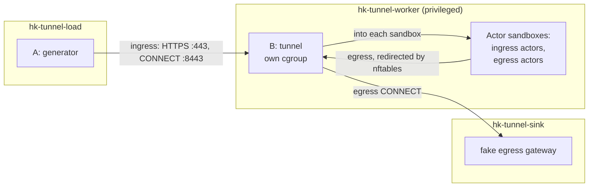

# Tunnel benchmark

Measures what the worker tunnel (the per-worker ingress and egress path in
`hivekeep-gate`) costs in CPU and memory as load rises. The tunnel is started,
and hosts its Actors, with the worker's own code, in a process of its own, so
the numbers are the tunnel's alone.



The generator (A) sends traffic through the tunnel (B) to stand-ins for what
the tunnel talks to in a cluster (C), reading B's CPU and memory as it goes,
and prints a table per scenario.

## Running

Linux containers only: the tunnel's Actors get real network namespaces and
nftables rules, so the worker container is privileged. On macOS, Docker
Desktop provides the Linux.

```sh
crates/hivekeep-bench-tunnel/run-docker.sh                                 # tunnel at 1 CPU, 1 GiB
crates/hivekeep-bench-tunnel/run-docker.sh --tunnel-cpus 2 --tunnel-memory 2g -- --rungs 2000,4000,8000
crates/hivekeep-bench-tunnel/run-docker.sh --cpuset-worker 0-3 --cpuset-rig 4-9 -- --scenarios Connect
```

Options before `--` shape the containers (`--tunnel-cpus`, `--tunnel-memory`,
`--actors`, `--cpuset-worker`, `--cpuset-rig`); everything after goes to
`hivekeep-tunnel-bench load` (`--scenarios`, `--rungs`, `--step`, `--warmup`,
`--workers`).

Each run writes `runs/<timestamp>/results.txt`, `results.json` and `logs/`.
Only `results.txt`, and a `report.md` if you write one, are meant to be kept.

Tests: `cargo test -p hivekeep-bench-tunnel` runs everything that needs no
privileges, including the whole ladder against the real tunnel on loopback.
The sandbox-network test needs Linux and root:
`sudo -E cargo test -p hivekeep-bench-tunnel --test workerhost_linux -- --ignored`.

## How it works

The benchmark is one program, `hivekeep-tunnel-bench`, with a subcommand per
process. `run-docker.sh` runs it in three containers on one Docker network:



| Subcommand | Container | Runs |
|---|---|---|
| `worker` | `hk-tunnel-worker` | the rest of the worker Pod: the fake keeper, `tunnel` in its own cgroup, and the Actors' stand-ins in the sandboxes |
| `tunnel` | `hk-tunnel-worker`, started by `worker` | the tunnel hosting Actors with the worker's code: the process measured |
| `ingress-actor`, `egress-actor` | `hk-tunnel-worker`, inside the sandboxes | the Actors' stand-ins, started by `worker` through `netns-exec` |
| `sink` | `hk-tunnel-sink` | the fake egress gateway |
| `load` | `hk-tunnel-load` | the load generator |
| `pki` | once, before the containers | the throwaway certificates the others share |

### What is real

`tunnel` makes the calls a worker makes, in the same order:
- at startup, `Tunnel::start` with the worker's own `--tunnel-*` flags;
- per Actor: `deactivate`, `prepare_egress` (minting the Actor certificate
  through the tunnel's own keeper client), the sandbox network, then
  `activate_egress` and `activate_ingress`;
- at teardown: `deactivate`, then removing the sandbox network.

Each Actor gets two network namespaces joined by a veth pair, the nftables
redirect of its TCP egress to the tunnel's egress listener, and the tunnel's
egress listener and DNS relay serving in its gateway namespace.

### What is faked

| In a worker | Stand-in |
|---|---|
| the keeper | `worker` serves the two keeper calls the tunnel makes: Actor certificate minting and egress policy |
| the Actor's program receiving requests | an ingress actor: a small HTTP server in each sandbox |
| the Actor's program making connections | an egress actor in each sandbox; EgressIdleConns splits its connections across them, the other egress scenarios use actor-0's |
| the router | the generator, presenting the router's identity |
| the egress gateway | `sink`, with the real gateway's HTTP/2 settings; it never dials out |
| Pod certificates | files from a throwaway CA |
| the sandbox runtime | nothing: the stand-ins run in the runtime namespace directly |

### How the tunnel is measured

- The tunnel runs in its own cgroup with the CPU and memory limits and no
  swap, so going over the limit is an OOM kill, as in a Pod. The stand-ins run
  outside it. If the tunnel dies, `worker` logs why and starts a fresh one.
- The generator is open loop: work is scheduled at a fixed rate whatever
  earlier requests take, and latency is measured from when each unit was due.
- Per rung the generator reads the tunnel's `/stats` (CPU, RSS, heap in use,
  async tasks, and the cgroup's accounting) when the warmup ends, every
  500 ms after, and when the rung ends.
- Heap figures come from a counting global allocator: memory allocated and not
  yet freed, which in Rust is what is live.

## Scenarios

Each scenario runs at every rate in `--rungs` (default `1000,2000,4000,8000`
per second), for `--step` (10s) each, leaving the first `--warmup` (2s) out.

| Scenario | What is sent | Tells you |
|---|---|---|
| IngressH1 | HTTPS GETs over HTTP/1.1 keep-alive to `:443`, the `hk-target-actor` header cycling over the Actors | CPU per request through the ingress reverse proxy |
| IngressH2 | the same over HTTP/2 | the same, multiplexed |
| Connect | per unit: a new TLS connection to `:8443`, `CONNECT actor:80`, one GET inside | cost of setting up a tunnel, mostly the TLS handshake |
| EgressHTTP | plain HTTP keep-alive from inside a sandbox | CPU per egress request on reused connections |
| EgressNewConnection | the same with a new connection per request | cost of a new egress connection |
| EgressIdleConns | rungs are connection counts: open at 200/s, one request each, hold | memory per open tunnel, read while held |
| EgressTCP | 4 connections write 64 KiB chunks as fast as they can; first rung only | throughput and CPU per byte |

## Caveats

- **Not covered:** the sandbox runtime itself, the real router and gateway,
  and Actors being activated and deactivated during load.
- **Shared machine.** The containers share the Docker host's CPUs; pin them
  apart with `--cpuset-worker` and `--cpuset-rig` for clean capacity numbers.
- **Ephemeral ports.** Connect and EgressNewConnection leave tens of thousands
  of sockets in TIME_WAIT. `run-docker.sh` widens the port range and enables
  `tcp_tw_reuse` in its containers, and the egress actor does the same in its
  sandbox.
- **No profiles.** The tunnel serves no CPU or heap profiles; attach `perf`
  to the tunnel process in the worker container if you need one.
