# Nighthawk egress benchmark

Measures Hivekeep's egress data plane, the sandbox tunnel to the gate egress
gateway, with [Nighthawk](https://github.com/envoyproxy/nighthawk). A
Nighthawk load generator runs inside a sandboxed Actor and sends to an
origin server outside it, so every request crosses the tunnel and the
gateway.

## Layout

```mermaid
flowchart LR
    client["nighthawk_client<br/>(your machine)"]
    gw["driver-gateway<br/>(:19980, sets hk-target-actor)"]
    router["gate-router<br/>(:443)"]

    subgraph worker["worker pod (gVisor)"]
        tin["tunnel, ingress"]
        actor["Actor egress-bench/driver<br/>(nighthawk_service :80)"]
        tout["tunnel, egress"]
    end

    egress["gate egress gateway<br/>(HTTP / HTTPS terminated / TLS passthrough)"]
    origin["egress-origin<br/>(:80, :443, :8443)"]

    client -->|"start a test"| gw
    gw -->|"gRPC + hk-target-actor: egress-bench/driver"| router
    router --> tin
    tin --> actor
    actor ==>|"test traffic"| tout
    tout ==>|"mTLS"| egress
    egress ==> origin
```



| Piece | Where | What |
|---|---|---|
| `egress-origin` | `egress-origin.yaml`, namespace `egress-bench` | Nighthawk's test server: HTTP on 80 and 8080, HTTPS on 443 and 8443 with a service DNS certificate |
| `driver-gateway` | `driver-gateway.yaml` | Envoy that adds the routing header nighthawk_client cannot set and forwards over mTLS to the gate router |
| `load-driver` WorkerPool | `load-driver-pool.yaml.tmpl` | one gVisor worker for the driver |
| `load-driver` ActorTemplate | `load-driver-template.yaml.tmpl`, hive `egress-bench` | nighthawk_service on port 80, trusting the gateway's minted leaves |
| `driver` Actor and its policy | `egress-policy.yaml` | the load driver; its policy allows HTTP on 80, HTTPS on 443 and TLS passthrough on 8443 |

## Prerequisites

1. Hivekeep installed, with the driver gateway's identity allowed to call
   Actor ingress:
   - an existing cluster (with `.hivekeep-dev-env.sh`):
     ```bash
     scripts/install/hivekeep.sh deploy hivekeep-system \
       --credential-provider='{"name":"k8s.io"}' \
       --ingress-allowed-spiffe-ids=spiffe://cluster.local/ns/egress-bench/sa/default
     ```
   - a local kind cluster:
     ```bash
     scripts/install/hivekeep-kind.sh deploy hivekeep-system \
       --credential-provider='{"enabled":false}' \
       --ingress-allowed-spiffe-ids=spiffe://cluster.local/ns/egress-bench/sa/default
     ```
   To measure the egress Envoy on one core, set its worker threads at
   install time with `HK_E2E_ENVOY_CONCURRENCY=1`. On kind, also give the
   gateway a CA bundle that includes the cluster's trust bundle, so it
   trusts the origin's certificate: `scripts/e2e/egress-tls-kind.sh`.
2. `hivectl` on `PATH` (`cargo install --path crates/hivekeep-ctl`), or
   `HIVECTL` pointing at it; otherwise the scripts build it.
3. Docker, to run nighthawk_client.

## Setup

```bash
# egress-origin and driver-gateway
crates/hivekeep-bench/nighthawk-egress/deploy.sh
# the WorkerPool, the template and the driver Actor
crates/hivekeep-bench/nighthawk-egress/deploy-load-driver.sh
# in another terminal
kubectl -n egress-bench port-forward svc/driver-gateway 19980:19980
```

`deploy-load-driver.sh` takes the snapshot location from
`HK_BENCH_SNAPSHOT_URI` (else `gs://$BUCKET_NAME`, or `--snapshot-uri`) and
the worker image from `WORKER_IMAGE` (else
`$HK_BUILD_REPO/hivekeep-sandbox-gvisor:<version>`, or `--worker-image`).

## Running

nighthawk_client talks to the forwarded driver gateway, which hands the call
to nighthawk_service inside the Actor:

```bash
docker run --rm --network=host --entrypoint /usr/local/bin/nighthawk_client \
  envoyproxy/nighthawk-dev@sha256:7729902afea9d83f593b240690ba7d6e8fff04f6215ada538cfb4c1452b2553e \
  --nighthawk-service grpc://127.0.0.1:19980 \
  --rps 1000 --concurrency 1 --protocol http1 --duration 60 \
  http://egress-origin.egress-bench.svc:80
```

Pick the egress mode by the target:

| Egress mode | Target | Port |
|---|---|---|
| plaintext HTTP | `http://egress-origin.egress-bench.svc:80` | 80 |
| HTTPS, terminated by the gateway | `https://egress-origin.egress-bench.svc:443` | 443 |
| TLS passthrough | `https://egress-origin.egress-bench.svc:8443` | 8443 |

See Nighthawk's documentation for every client option.

## Cleanup

```bash
crates/hivekeep-bench/nighthawk-egress/deploy-load-driver.sh --delete   # Actor, template, hive, pool
crates/hivekeep-bench/nighthawk-egress/deploy.sh --delete               # origin and gateway
kubectl delete namespace egress-bench
```

Delete the namespace last: the Actor, template and hive live in the
Hivekeep API, not in the namespace, and the WorkerPool must go first.
