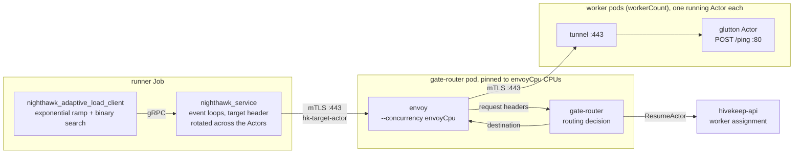

# Nighthawk gate router capacity benchmark

## What it answers

Per Envoy CPU size of the gate router's ingress path:

> **What is the highest request rate the ingress path sustains while tail
> latency stays under the SLO?**\*

[Nighthawk](https://github.com/envoyproxy/nighthawk), Envoy's benchmarking
client, finds the number in its adaptive mode: it ramps open-loop load until
a threshold breaks, binary-searches the boundary, and confirms the result
with a longer run. Run it across `envoyCpu` sizes for a capacity-per-core
curve, or regularly to catch regressions on the routing path.

\* *The SLO bounds latency **mean + 2 stdev**, not a true percentile: the
adaptive search can only gate on Nighthawk's built-in metrics (success rate,
send rate, rps, latency mean and stdev). For bell-shaped latency mean + 2
stdev sits around p95-p97. True p50/p95/p99 are still reported per stage;
they just do not steer the search.*

## What a request goes through

Every request takes the full production path: warmed sandboxed Actors,
routing by the `hk-target-actor` header, the router's routing decision, and
the mTLS hop to the worker.



The measured latency thus covers the network to Envoy, Envoy itself, the
routing decision (including its hivekeep-api lookup), the mTLS hop and the
Actor's handler.

**Capacity means all three thresholds hold at once**; each sees a failure
the others miss:

| Threshold (tests.yaml knob) | Catches | Symptom at the limit |
|---|---|---|
| `tailLatencySloMs`: latency mean + 2 stdev <= X ms | the router getting slow | queues build in Envoy and the router; the tail climbs past the SLO |
| `successRateThreshold` (0.999) | the router getting fast but wrong | 503s from parking overflow, 504 route timeouts |
| `sendRateThreshold` (0.9) | the client failing to deliver the load | paced requests skipped once latency x rate outgrows the connection pools |

## How it runs

One Kubernetes Job per `type: nighthawk-ingress` entry, driven by the
[automation](../automation/README.md):

1. **Pin the router.** The orchestrator patches the `gate-router`
   Deployment: both containers get CPU requests = limits = `envoyCpu`
   (Guaranteed QoS) and Envoy runs with `--concurrency envoyCpu`. It waits
   for the rollout; every test reinstalls Hivekeep afterwards.
2. **Create and warm the Actors.** The runner creates one glutton Actor per
   worker (the entry's `workerCount`) through hivekeep-api and POSTs `/ping`
   through the router with each Actor's header until it answers 200.
3. **Adaptive search.** Open-loop traffic with the header rotated across the
   Actors, from `clientConcurrency` event loops (default 16, independent of
   `envoyCpu`) with large per-loop pools so the client is never the limit.
   Exponential ramp, binary search, then a 60 s **testing stage** at the
   converged rate.
4. **Upload the results** (below). The Job exits 0 only if the session
   converged and every artifact uploaded.

## Running it

### From the automation

Add an entry to the tests file:

```yaml
- name: ingress_routercap_envoy_2cpu
  type: nighthawk-ingress
  targetCluster: dev
  duration: 30m          # the Job wait budget only
  workerCount: 50        # also the fleet size: one warm Actor per worker
  nighthawk-ingress:
    envoyCpu: 2
    tailLatencySloMs: 25
```

### On a development cluster

Once: a cluster with nodes big enough for the two large pods (the router pod
requests 2 x `envoyCpu` CPUs, the runner `clientConcurrency` + 1), then:

```bash
scripts/install/hivekeep.sh deploy hivekeep-system \
  --credential-provider='{"name":"k8s.io"}' \
  --ingress-allowed-spiffe-ids=spiffe://cluster.local/ns/benchmarking/sa/benchmark-runner
crates/hivekeep-bench/workloads/deploy.sh --deploy --worker-count 50 --sandbox-class gvisor
```

Each run is then one command of about 8-10 minutes:

```bash
crates/hivekeep-bench/nighthawk-ingress/run-dev.sh --envoy-cpu 2
```

[`run-dev.sh`](run-dev.sh) runs only the benchmark: it checks the
prerequisites (printing the fix for anything missing), pins the router when
its CPU differs from `--envoy-cpu` (so a CPU sweep needs no reinstall),
builds the runner image from the working tree (uncommitted changes included;
such runs are tagged `-dirty`), submits the Job, follows its log and prints
`capacity.json`. Flags: `--envoy-cpu`, `--actors`, `--tail-latency-slo-ms`,
`--hive`, `--dest`. It needs Docker and gcloud/kubectl credentials. It never
reinstalls Hivekeep: after changing Hivekeep itself, rerun the install
first. `--hive` keeps Actor fleets of different experiments apart, but a
capacity run still needs the router to itself (the CPU pin is global and the
run saturates it).

### Results

Artifacts land under
`<dest>/runs/<name>/run_date=.../run_ts=.../run_tag=<commit>/`. Start with
`capacity.json`, then `stats.jsonl`:

| file | contents |
|---|---|
| `capacity.json` | the verdict: `slo_max_rps`, the highest rate that passed every threshold (the number to track); `binding_threshold`, which limit set it; the testing stage's metrics and p50/p95/p99 |
| `stats.jsonl` | one record per stage: Nighthawk's built-in metrics as `metric_nighthawk.builtin_*` (`achieved_rps` counts requests sent, errors included), status counts, latency percentiles and the stage's `failed_thresholds` |
| `results.json` | the whole session as Nighthawk wrote it |
| `spec.textproto`, `output.textproto` | Nighthawk's exact input and output |
| `status.json`, `logs.txt` | run metadata and process logs |

## Configuration knobs (the `nighthawk-ingress:` block)

The fleet size is the entry's top-level `workerCount` (required): one Actor
per worker. Everything else:

| Knob | Default | Meaning |
|---|---|---|
| `envoyCpu` | required | CPU requests = limits of both router containers, and Envoy's `--concurrency`; the independent variable |
| `hive` | `ingress-benchmark` | hive of the Actors; name it per experiment, never per run (hives are never deleted automatically) |
| `tailLatencySloMs` | 0 (off) | the SLO: upper bound on latency mean + 2 stdev, in ms |
| `successRateThreshold` | 0.999 | lowest 2xx fraction of sent requests |
| `sendRateThreshold` | 0.9 | lowest sent fraction of the paced schedule (the open-loop backstop) |
| `clientConcurrency` | 16 | Nighthawk event loops; the Job requests `clientConcurrency + 1` CPUs; independent of `envoyCpu` |
| `connections` | 1000 | client connections per event loop |
| `maxPendingRequests` | 10000 | client queue per event loop |
| `initialRps` | 500 | total starting rate of the ramp |
| `exponentialFactor` | 2.0 | ramp multiplier per step; smaller brackets the knee tighter, in more steps |
| `measuringPeriod` | 10s | length of each search step |
| `convergenceDeadline` | 600s | the session fails if the search has not converged by then |
| `testingStageDuration` | 60s | the confirming run at the converged rate |
| `apiClientAuth` | `cert` | how the runner authenticates to hivekeep-api: `cert` (pod identity) or `token` (projected ServiceAccount token) |

## Sizing: measure the router, not the rig

Client, router and Actor fleet sit in series, and the reported capacity is
whichever saturates first. Client and fleet must each handle about twice the
capacity you expect: the ramp overshoots before it converges, and the rig
must survive those stages too. A failed stage in `stats.jsonl` says who gave
out:

- `send_rate` below its threshold: the client; raise `clientConcurrency`.
- 502s: the Actor fleet; raise `workerCount`.
- latency rising smoothly into the SLO: the router, which is the
  measurement.

## Tests

```bash
cd crates/hivekeep-bench/nighthawk-ingress && python3 -m pytest tests
```

`test_spec_round_trips_through_real_protos` needs the descriptor set and
returns early outside the runner image; inside it:
`docker run --rm --entrypoint python3 <image> -m pytest /app/tests`.
